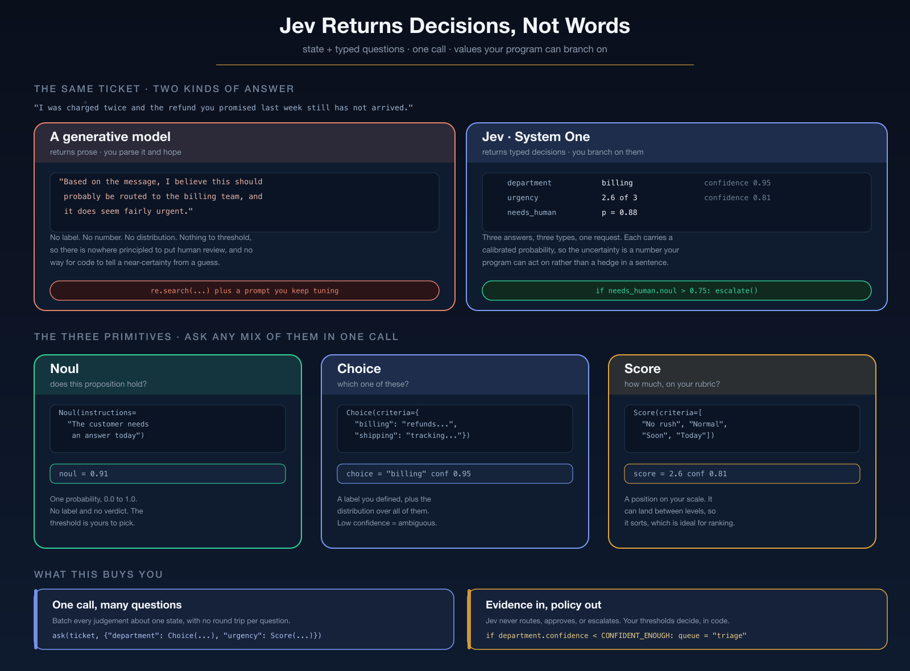

# Learning Jev

**Jev** is [TypeSafe](https://typesafe.ai)'s first *System One* model. It does not
generate text. You give it a **state** — whatever your program already knows —
plus a set of **typed questions**, and it answers them all in one call as values
your code can branch on:

```
state + questions  ->  Jev  ->  typed decisions + probabilities  ->  ordinary program logic
```

That shape is the whole idea, and it leads somewhere specific: **the model
supplies evidence, your software owns the policy.** Every threshold in this
folder is a plain number in plain Python, reviewable without reading a prompt.

`jev_tutorial.ipynb` is six lessons, from the architecture to a working router.
It needs a Databricks workspace with Jev registered behind the Unity AI Gateway.

---

## The tutorial



Six lessons. The first two are reading; the rest make real calls.

| Lesson | What you learn |
|---|---|
| 1 | Why TypeSafe built Jev, and the judgment/action split |
| 2 | The three primitives — `Noul`, `Choice`, `Score` |
| 3 | Your first API call |
| 4 | Asking several questions in one call |
| 5 | Working with uncertainty: confidence and thresholds |
| 6 | Building a complete AI workflow |

Three primitives, and that is the entire surface:

| Primitive | Asks | Returns | Reach for it when |
|---|---|---|---|
| `Noul` | does this proposition hold? | one probability, `0.0`–`1.0` | you want to threshold a yes/no |
| `Choice` | which one of these? | a label you defined, plus the full distribution and `confidence` | routing, classification, tool selection |
| `Score` | how much, on your rubric? | a position on your ordered scale, plus `confidence` | ranking, relevance, triage |

One method takes any mix of them and answers them all in **one** request:

```python
from jevai import router
from jevai.jev_client import Choice, JevClient, Noul, Score

answers = JevClient().system_one(
    state=ticket,
    questions={
        'department':  Choice(instructions='Which team should handle this', criteria=router.DEPARTMENTS),
        'urgency':     Score(instructions='How soon they need an answer', criteria=router.URGENCY),
        'needs_human': Noul(instructions='This ticket needs a human agent'),
    },
).answers

answers['department'].choice       # 'billing'
answers['department'].confidence   # 0.95
answers['urgency'].score           # 2.8, on the rubric you supplied
answers['needs_human'].noul        # 0.91
```

`router.py` is what you build with that — about 110 lines, and the interesting
half is not the Jev call:

```python
CONFIDENT_ENOUGH = 0.60      # below this we do not trust the department label
HUMAN_ABOVE = 0.75
PRIORITY_AT_OR_ABOVE = 2.5
```

Those three numbers are the routing policy. Jev never routes anything — it
returns a label, a level, and a probability, and the `if` statements decide what
they are worth. Lesson 1 spends its time on exactly that line:


The payoff is the ambiguous ticket: *"This is completely
unacceptable. I've had enough of this. Sort it out."* comes back as `billing` at
`0.21` confidence, so it lands in `triage` instead of being confidently
misrouted. Nothing in the model decided that.

### Reaching Jev

Jev is served from your own workspace through the Databricks Unity AI Gateway,
on its own route:

```
POST {DATABRICKS_HOST}/ai-gateway/typesafe/v1/systemone
```

So there is nothing to install — no `typesafe-sdk`, no second vendor account,
and no re-resolve of this repo's `uv.lock` (which currently hits a pre-existing
`crewai`/`deepeval` conflict). `jev_client.py` is a ~260-line module over
`requests`, which is already in the environment.

Put four values in `jevai/.env`:

```
DATABRICKS_HOST=https://your-workspace.cloud.databricks.com
DATABRICKS_TOKEN=dapi...
JEV_MODEL=catalog.schema.your_jev_endpoint
JEVAI_MODEL=catalog.schema.your_chat_endpoint
```

`JEV_MODEL` and `JEVAI_MODEL` are both **Unity Catalog endpoint paths**, not bare
model names. They are two different endpoints on two different gateway routes:
Jev answers typed questions on `/ai-gateway/typesafe/v1/systemone`, and the chat
model writes prose on the OpenAI-compatible `/ai-gateway/mlflow/v1`.
`JevClient()` reads the first three with no arguments and raises with the name of
whichever one is missing rather than failing later as a `401`. Lesson 6.2 reads
`JEVAI_MODEL` the same way. `JEV_GATEWAY_URL` and `JEVAI_GATEWAY_URL` optionally
override the two derived URLs.


The tutorial reads **only** `jevai/.env`. `jev_client.py` loads that file itself,
so the credentials hold regardless of what a notebook cell did first. Note that
The two names are one character apart and easy to swap by mistake: `JEV_MODEL` is
the Jev endpoint, `JEVAI_MODEL` is the chat endpoint Lesson 6.2 writes with.

Lessons 1 and 2 are reading only, so you can start the tutorial before setting
any of this up. Lessons 3–6 call the gateway.

---

## Files

| File | Lines | What it does |
|---|---|---|
| `jev_client.py` | ~260 | The gateway client — `Noul`/`Choice`/`Score` in, typed answers out. |
| `router.py` | ~110 | The smallest useful Jev app — `decide()` is the policy, `route()` adds the Jev call. |
| `jev_tutorial.ipynb` | — | **Start here.** Six lessons. |
| `images/` | — | The three diagrams, each as `.png` plus editable `.svg`. |

## Running it

```bash
# Needs DATABRICKS_HOST/_TOKEN + JEV_MODEL, no MLflow
uv run jupyter notebook jevai/jev_tutorial.ipynb
```

Lesson 6 also uses an LLM to write the customer-facing reply, and it comes through
the *same* gateway on a different route: `/ai-gateway/mlflow/v1` rather than
`/ai-gateway/typesafe/v1/systemone`. It reuses `DATABRICKS_HOST` and
`DATABRICKS_TOKEN`, and reads the chat endpoint from `JEVAI_MODEL`. Only Lesson 6
needs that one, so Lessons 1 through 5 run without it. That cell imports `openai`,
which is only the client library: the mlflow route speaks an OpenAI-compatible
API, so the request goes to your own workspace and never to OpenAI.

## Two gotchas worth knowing

- **`Noul` has no `confidence`.** `Choice` and `Score` answers carry one;
  `Noul` does not, because its probability *is* the uncertainty — `0.5` is the
  model saying it does not know. For a Choice-comparable number, compute
  `abs(2 * answer.noul - 1)` yourself.
- **A `Score`'s `probabilities` and `legend` are keyed by `int`**, not by the
  rubric strings — `answers['urgency'].legend[2]` wants an integer. And `score`
  is continuous: `2.8` means the mass sits between levels 2 and 3, not that
  there is a level 2.8.

## Where to take it next

- Set `CONFIDENT_ENOUGH = 0.15` in `router.py` and watch the ambiguous ticket get
  confidently misrouted. The model did not get worse — your policy did.
- Add a fourth question to `router.QUESTIONS`. It costs no extra round trip.
